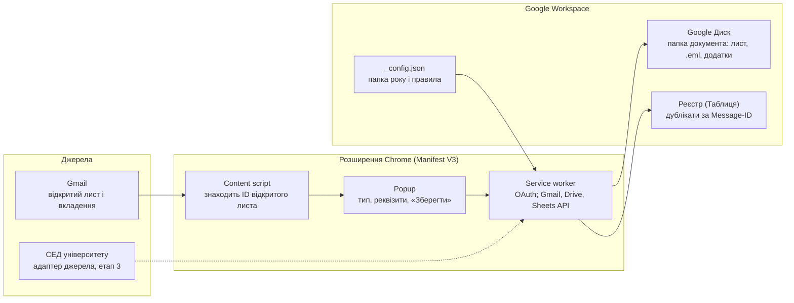

# ТЗ: розширення Chrome «Вхідна документація кафедри»

Версія від 10.11.2026

## 1. Призначення

Розширення Google Chrome одним натисканням зберігає відкритий у Gmail вхідний документ разом із додатками у спільну кафедральну папку «Вхідна документація» на Google Диску. Воно також записує документ у реєстр, щоб уникнути дублювання. Мета — спростити документообіг кафедри: діловод і працівники бачать усі вхідні накази, розпорядження та листи в одному місці.

Наступним етапом розширення отримає друге джерело документів — систему електронного документообігу (СЕД) університету.

## 2. Користувачі та ролі

| Роль | Що робить | Доступ до папки |
| --- | --- | --- |
| Діловод | Зберігає документи, уточнює тип і реквізити, веде реєстр | Редагування |
| Працівники кафедри | Уповноважені завкафедри працівники зберігають документи; решта переглядає документи та реєстр | Редагування — уповноважені; перегляд — решта |
| Завкафедри (адміністратор) | Зберігає документи, надає права працівникам, створює папку року, редагує спільні налаштування (`_config.json`) | Керування |

## 3. Загальна архітектура

Розширення працює без власного сервера: усі дані йдуть напряму між браузером користувача та Google Workspace університету.



Content script знаходить відкритий лист, popup збирає тип і реквізити, service worker завантажує лист через Gmail API і записує файли на Диск та рядок у реєстр. Налаштування (папка року, правила) service worker читає з `_config.json`. Пунктиром позначено джерело наступного етапу.

- **Модульність.** Логіка побудована за схемою «джерело → уніфікована модель документа → сховище». Модель документа містить реквізити, тіло, вкладення та ідентифікатор для перевірки дублікатів. Джерело «СЕД» додається як ще один адаптер без змін у збереженні та реєстрі.
- **Авторизація.** `chrome.identity` (OAuth 2.0) з акаунтом користувача; кожен працює під своїм Google-акаунтом і своїми правами доступу до папки.
- **Стек.** JavaScript або TypeScript, без зовнішніх серверних залежностей; конвертація HTML-тіла листа в Markdown — у браузері (напр. бібліотекою Turndown).

## 4. Структура та налаштування Google Диска

Користувач один раз вказує в розширенні спільну кафедральну папку «Вхідна документація». Усе інше, зокрема поточну папку навчального року, розширення бере зі спільного файлу налаштувань у цій папці. Так усі працівники зберігають в одне місце, а перехід на новий рік робиться один раз для всіх.

### 4.1. Структура (плоска, без підпапок за типом)

```
Вхідна документація/                      ← спільна папка кафедри (задається один раз)
├── _config.json                          ← спільні налаштування (редагує адміністратор)
├── 2025-2026/
└── 2026-2027/                            ← папка поточного навчального року
    ├── Реєстр вхідних документів 2026-2027   (Google Таблиця)
    ├── 2026-11-10_Наказ_№123-к_Про організацію навчального процесу/
    │   ├── Лист.md
    │   ├── Оригінал.eml
    │   └── додатки…
    ├── 2026-11-10_Розпорядження_№45_Про чергування/
    └── 2026-11-11_Вхідний лист_МОН_Щодо акредитації/
```

- Підпапок за типом і роком усередині папки року немає. Тип документа вказується в назві та в реєстрі; групування й фільтрація робляться через реєстр.
- Кожен документ отримує окрему папку, навіть без додатків. Так лист і вкладення завжди лежать разом.
- Шаблон назви: `{дата}_{тип}_№{номер}_{короткий зміст}`. Дата — дата надходження листа у форматі РРРР-ММ-ДД, щоб папки сортувалися хронологічно. Якщо номера немає, частина `№…` пропускається. Недопустимі символи (`/ \ : * ? " < > |`) прибираються, зміст обрізається до 80 символів.
- Папку краще розмістити на Спільному диску (Shared Drive) кафедри. Тоді файли належать кафедрі, а не особистому акаунту.

### 4.2. Де і як задається папка

| Що | Де задається | Хто | Як часто |
| --- | --- | --- | --- |
| Коренева папка «Вхідна документація» | Сторінка налаштувань розширення: вставити посилання на папку або обрати її через Google Picker. Зберігається в `chrome.storage.sync`, тож переноситься на інші комп’ютери користувача | Кожен користувач (або централізовано, див. нижче) | Один раз |
| Папка поточного навчального року | Поле `currentYearFolder` у `_config.json` | Адміністратор | Раз на рік |
| Типи документів, правила класифікації, шаблон назви | `_config.json` | Адміністратор | За потреби |

- **Централізоване налаштування (опційно).** Якщо розширення встановлюється через Google Admin Console, посилання на кореневу папку можна задати політикою (`chrome.storage.managed`). Тоді працівникам нічого налаштовувати не потрібно.
- **Перехід на новий рік.** Адміністратор створює папку `2027-2028` і вказує її в `_config.json` (або обирає в налаштуваннях розширення, яке саме оновить конфіг). Реєстр у новій папці розширення створює автоматично під час першого збереження. Якщо `currentYearFolder` не вказано, розширення використовує папку навчального року за поточною датою (рік починається 1 вересня) і створює її, якщо її немає.
- **Підказка в інтерфейсі.** У вікні розширення завжди видно шлях збереження, наприклад «Вхідна документація / 2026-2027», щоб користувач бачив, куди йде документ.
- **Перевірка доступу.** Кнопка «Перевірити доступ» на сторінці налаштувань перевіряє: папка існує, у користувача є право запису, конфіг читається, реєстр доступний.

### 4.3. Приклад `_config.json`

```json
{
  "currentYearFolder": "2026-2027",
  "documentTypes": ["Наказ", "Розпорядження", "Вхідний лист", "Службова записка", "Протокол", "Інше"],
  "rules": [
    { "type": "Наказ", "subjectContains": ["наказ"] },
    { "type": "Розпорядження", "subjectContains": ["розпорядження"] },
    { "type": "Вхідний лист", "fromDomains": ["mon.gov.ua"] }
  ],
  "folderNameTemplate": "{date}_{type}_№{number}_{summary}",
  "bodyFormat": "markdown",
  "alsoSavePdf": false
}
```

## 5. Функціональні вимоги

### 5.1. Отримання листа з Gmail

- Розширення працює на вкладці `mail.google.com`, коли відкрито конкретний лист.
- Content script визначає ідентифікатор відкритого листа з DOM, а не з URL, бо формат URL у Gmail не збігається з ID у Gmail API.
- Через Gmail API завантажуються:
  - метадані: відправник, отримувачі, тема, дата, заголовок Message-ID;
  - тіло листа (HTML і текст);
  - усі вкладення;
  - оригінал листа у форматі .eml.
- Якщо в ланцюжку кілька листів, користувач обирає потрібний. За замовчуванням береться останній розгорнутий.
- Якщо лист не відкрито, кнопка «Зберегти» неактивна і показується підказка «Відкрийте лист у Gmail».

### 5.2. Вікно перед збереженням (popup)

- Шлях збереження: «Вхідна документація / 2026-2027».
- Тип документа визначається автоматично (5.3), користувач може змінити його зі списку.
- Поля, які можна редагувати: номер документа, дата документа, від кого, короткий зміст, примітка.
- Попередній перегляд назви папки, яку буде створено.
- Список вкладень із чекбоксами (за замовчуванням обрано всі).
- Кнопка **«Зберегти»** та індикатор прогресу.
- Якщо документ уже є в реєстрі, показується попередження «Вже збережено» з датою, автором і посиланням на папку. Повторне збереження можливе лише після явного підтвердження.
- Після успішного збереження показуються посилання «Відкрити папку» і «Відкрити реєстр».

### 5.3. Визначення типу та реквізитів

- Тип визначається за правилами з `_config.json`: ключові слова в темі й тілі листа, адреси та домени відправників. Якщо жодне правило не спрацювало, ставиться «Інше».
- Номер і дата документа шукаються регулярними виразами в темі, тілі та назвах вкладень (напр. «№ 123-к від 05.11.2026»).
- Короткий зміст за замовчуванням — тема листа без службових префіксів (`Fwd:`, `Re:`, `Fw:`).
- *(Етап 3, опційно)* визначення типу та реквізитів через LLM.

### 5.4. Збереження

- У папці поточного року створюється папка документа за шаблоном (4.1).
- У неї зберігаються:
  - тіло листа у файлі `Лист.md` (Markdown): на початку блок метаданих (від кого, кому, дата, тема, перелік додатків), далі тіло, конвертоване з HTML (таблиці — Markdown-таблицями); за налаштуванням `alsoSavePdf` додатково зберігається PDF;
  - оригінал листа `Оригінал.eml`;
  - обрані вкладення в оригінальному форматі з оригінальними назвами.
- Файли понад 5 МБ завантажуються через resumable upload.
- Якщо папка з такою назвою вже існує (інший документ того ж дня з тією ж назвою), до назви додається суфікс `_2`, `_3`.

### 5.5. Реєстр

Реєстр — Google Таблиця в корені папки року, створюється автоматично під час першого збереження в новому році.

| Колонка | Зміст |
| --- | --- |
| № | Порядковий номер у межах року |
| Дата надходження | Дата листа |
| Тип | Наказ, Розпорядження, … |
| № документа | Як у документі |
| Дата документа | Як у документі |
| Від кого | Відправник або установа |
| Короткий зміст | Текст |
| Додатків | Кількість файлів |
| Папка | Посилання на папку документа |
| Зберіг | Хто зберіг (email) |
| Коли збережено | Дата й час |
| Message-ID | Службова, прихована |
| MD5 вкладень | Службова, прихована |

- Дублікат визначається за Message-ID. Додатково перевіряється збіг MD5 вкладень, бо той самий наказ може прийти різними листами.
- Перевірка охоплює реєстр поточного року та, опційно, попереднього (листи кінця серпня).
- Рядки додаються через `values.append`, тож кілька користувачів можуть зберігати одночасно.

### 5.6. Обробка помилок

- Повідомлення українською: немає доступу до папки, папку не знайдено, конфіг пошкоджено, завеликий файл, втрачено з’єднання, сплив термін авторизації.
- Рядок у реєстр додається лише після успішного завантаження всіх файлів. Якщо частина файлів не завантажилася, користувач бачить, що саме, і може повторити спробу; вже створена папка використовується повторно.
- Локальний журнал останніх 50 операцій на сторінці налаштувань для діагностики.

## 6. Нефункціональні вимоги

- Інтерфейс українською мовою.
- Власного сервера немає: дані передаються лише між браузером користувача та сервісами Google університету.
- Мінімальні OAuth-scopes:
  - `gmail.readonly`;
  - `drive` (потрібен, бо папка спільна і створена не розширенням; `drive.file` не підходить);
  - `spreadsheets`.
- OAuth-клієнт типу **Internal** у Google Cloud-проєкті домену університету. Тоді не потрібна верифікація Google для обмежених scopes.
- Поширення: приватна публікація в Chrome Web Store для домену або примусове встановлення через Google Admin Console.
- Продуктивність: лист із 5 вкладеннями загальним обсягом до 10 МБ зберігається не довше 15 с.
- Код модульний і документований, у репозиторії кафедри; README з інструкцією встановлення та налаштування.
- Сумісність: актуальна версія Google Chrome (Manifest V3); робота в інших Chromium-браузерах — бажано, не обов’язково.

## 7. Етапи та критерії приймання

| Етап | Зміст |
| --- | --- |
| 1. MVP | Збереження відкритого листа з вкладеннями, ручний вибір типу, плоска структура, реєстр, перевірка дублікатів, налаштування кореневої папки та `_config.json` |
| 2. Автоматизація | Правила класифікації, витягування номера й дати, централізоване налаштування через Admin Console |
| 3. СЕД | Адаптер джерела «СЕД»: імпорт документів із системи електронного документообігу в ту саму структуру й реєстр; опційно LLM-класифікація |
| 4. Опційно | Сповіщення працівників про нові документи (пошта або чат) |

**Критерії приймання MVP:**

1. Діловод відкриває лист із наказом і двома PDF-додатками, натискає «Зберегти». У папці року з’являється папка `2026-11-10_Наказ_№…_…` з листом, .eml і обома додатками, а в реєстрі — новий рядок.
2. Повторна спроба зберегти той самий лист показує попередження про дублікат із посиланням на вже збережену папку.
3. Інший працівник кафедри бачить документ у папці та реєстрі без додаткових дій.
4. Після зміни `currentYearFolder` у `_config.json` наступне збереження потрапляє в нову папку, де автоматично створюється новий реєстр.
5. Користувач без права запису отримує зрозуміле повідомлення, і нічого не зберігається частково.

## 8. Відкриті питання

До уточнення в ТЗ прийнято варіанти за замовчуванням, позначені нижче.

- [ ] Акаунти кафедри — Google Workspace університету (@nuwm.edu.ua) чи особисті Gmail? *За замовчуванням: Workspace, OAuth-клієнт Internal.*
- [x] Папка «Вхідна документація» — на Спільному диску чи в «Моєму диску» когось із працівників? *За замовчуванням: Спільний диск кафедри.*
- [ ] Остаточний перелік типів документів і адреси, з яких зазвичай надходять накази та розпорядження.
- [x] Чи потрібен власний вхідний номер кафедри (журнал реєстрації), чи достатньо порядкового № у реєстрі?
- [x] Формат тіла листа. *Вирішено: Markdown (.md) + оригінал .eml; PDF — опційно.*
- [x] Хто зберігає документи. *Вирішено: діловод, завкафедри та уповноважені працівники; права задаються доступом до папки.*
- [ ] Яка СЕД використовується в університеті і чи має вона API або експорт? *Відкладено до етапу 3.*
